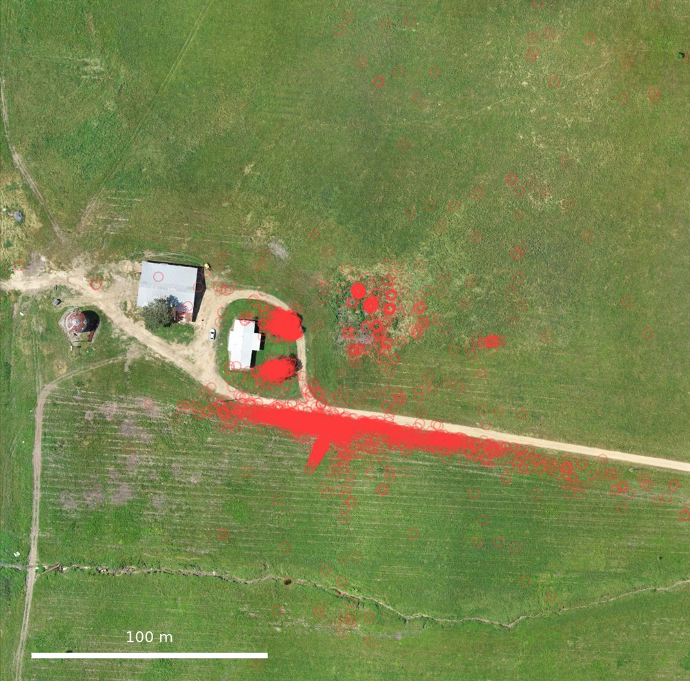
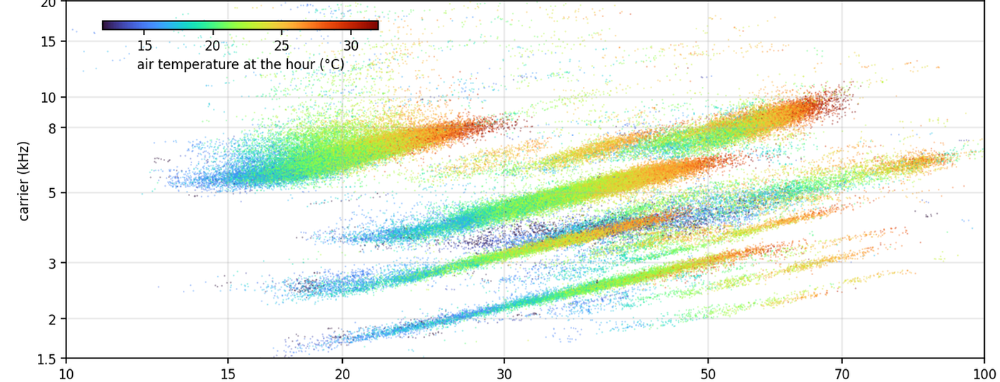
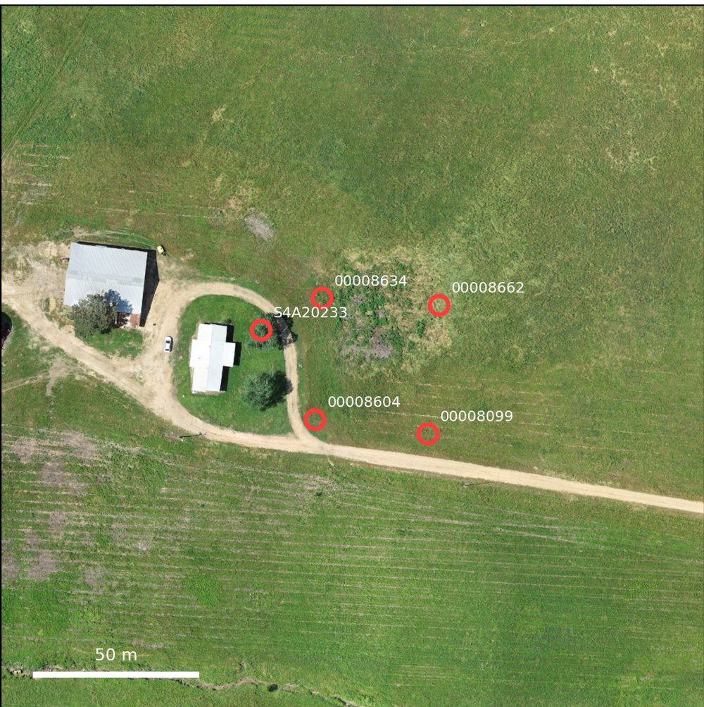

# Cardinal Acoustics

**Open tools for listening to a landscape with arrays of autonomous recorders.**

Since 2023 we have kept 27 autonomous recording units running around the clock on a 400-hectare former pasture in
southwestern Arkansas that is being returned to native forest. The archive is past 400,000 recorder-hours. Two
open-source projects grew out of the question of what to do with that much sound. **Cardinal** answers *where* a bird
is calling, by combining recorders into small arrays and localizing each call in three dimensions. **BROOKS** answers
*who is singing and when* for the insects that dominate the soundscape from spring to late fall, by finding every
rhythmic singer in the recordings and following it through the night. Both run unattended on recordings as they come
off the SD cards, and both are built to be used on other people's arrays.

<table>
<tr>
<td width="50%" valign="top">

## Cardinal

**Where is the bird?** Three-dimensional localization of bird vocalizations from small passive acoustic arrays.

*A year of high-quality localizations at one station. Birds sing from the trees, the buildings and the fence line, not
from the open field.*

Given a folder of recordings from an array of recorders with known positions, Cardinal catalogs every file, runs
[BirdNET](https://github.com/kahst/BirdNET-Analyzer) to detect species, cross-checks detections across recorders, and
localizes each event by time difference of arrival, fitting the source position and the local speed of sound together.
It works in the places where localization is hard: forest edges, creek-side woodland and open pasture, with recorders
tens of meters apart.

- **Code:** [cardinal-acoustics/cardinal](https://github.com/cardinal-acoustics/cardinal) (MIT), with a demo that runs
  end to end on a day of recordings from six recorders.
- **Paper:** Eisen, M. B., Brown, P. O. & Matias, A. S. (2026). Automated localization of calling birds with small
  passive acoustic arrays in complex soundscapes. *bioRxiv*.
- **Recorders:** Frontier Labs Solar BAR and Wildlife Acoustics SM4/S4A units are supported out of the box.

</td>
<td width="50%" valign="top">

## BROOKS

**Who is singing, and when?** An unsupervised inventory of orthopteran song from continuous recordings.

*A year of trilling insects, each hour of each singer a point, placed by its carrier frequency and syllable rate and
colored by the air temperature. Every line is a call type; its singers slide up the line as the night warms.*

BROOKS (Bioacoustic Records of Orthopteran Oscillators, Keyed by Song) finds every rhythmically repeating song in a
five-minute window of audio without reference recordings or training data, follows each singer through the night as
its rate and pitch change with temperature, and assembles a year of singers into call types. From one site and one
year it recovered 37 trilling and 8 chirping types, their seasons, their habitats, and how each one's song responds to
temperature. It is named for Margarette Brooks, who in 1881 first timed a cricket against a thermometer.

- **Code and data:** [cardinal-acoustics/brooks](https://github.com/cardinal-acoustics/brooks) (MIT; data CC BY 4.0),
  with a two-minute demo, the year's tables, the figures and the per-type quality-control pages.
- **Paper:** Eisen, M. B. (2026). A comprehensive inventory of discrete insect songs from long-term continuously
  operating field recorders. *bioRxiv*, in preparation.

</td>
</tr>
</table>

## How the two fit together

The same recorders feed both. Cardinal keeps the catalog of recordings, positions and recorder groups and handles the
per-file bookkeeping; BROOKS reads the same archive layout and the same hourly weather tables. One listens to the birds
of the day and places them on the map; the other listens to the insects of the night and places them on a plane of
pitch against rhythm. Together they turn an archive of raw audio into two inventories that can be compared across
seasons, years and places, with no manual annotation in between.

<table>
<tr>
<td width="50%" valign="top">

<em>One array: five recorders around a farmhouse, tens of meters apart.</em>
</td>
<td width="50%" valign="top">

<em>One night at that station as BROOKS sees it: bands of insect song falling in pitch as the night cools.</em>
</td>
</tr>
</table>

## The site

The recordings come from a property in Hempstead County, Arkansas, that was pasture until 2022 and is now the site of
experiments on restoring native forest and the biodiversity that comes with it, a collaboration with Patrick O. Brown
(Stanford University) and the Impossible Foundation. Recorders stand at eleven stations spanning creek-side woodland,
a pine-plantation edge, ponds and open former pasture; four stations carry several recorders a few tens of meters apart
for localization. Air temperature comes from NOAA's HRRR model, and since September 2026 from weather stations at the
main stations.

## Using the tools on your own recordings

Both packages are plain Python. Each repository has an installation section, a demo on real data that needs no site
setup, and a description of the folder layout the recorders' files should follow. Cardinal is configured by a single
`cardinal.toml`; BROOKS by a few environment variables and the module constants documented at the top of each file.
Issues and pull requests are welcome in either repository.

## People

Michael Eisen (University of California, Berkeley; Howard Hughes Medical Institute), with Patrick O. Brown and Ana
Sanz Matias. Contact: mbeisen@berkeley.edu.
